<div align="center">

# ✈️ CHERISH TRAVEL

### Premium Flight Booking System

**Platform Pemesanan Tiket Pesawat Modern**

*Project Ujian Tengah Semester (UTS) — Pemrograman Web dengan Laravel*

[](https://laravel.com)
[](https://php.net)
[](https://mysql.com)
[](https://tailwindcss.com)

</div>

---

## 📖 Tentang Project

**CHERISH TRAVEL** adalah platform reservasi tiket penerbangan modern yang dibangun menggunakan framework **Laravel**. Aplikasi ini menggabungkan kemudahan teknologi dengan sentuhan kemewahan dan pelayanan berkelas untuk pengalaman pemesanan tiket pesawat yang optimal.

### 🎯 Tujuan
Membangun sistem pemesanan tiket pesawat berbasis web yang mencakup:
- Pencarian & pemesanan penerbangan domestik dan internasional
- Penerbitan E-Ticket resmi dengan QR Code
- Dashboard admin untuk manajemen data penerbangan

---

## ✨ Fitur Utama

### 🌐 Halaman Publik (User)
| Fitur | Deskripsi |
|-------|-----------|
| 🏠 **Beranda** | Landing page dengan promo, destinasi domestik & internasional, maskapai rekanan |
| 🔍 **Pencarian Penerbangan** | Cari penerbangan berdasarkan kota asal, tujuan, tanggal, dan jumlah penumpang |
| 📝 **Pemesanan Tiket** | Form pemesanan lengkap dengan data pemesan & penumpang, pilihan kursi, bagasi |
| 🎫 **E-Ticket** | Tiket elektronik resmi dengan kode booking (PNR) dan QR Code |
| 📞 **Kontak** | Halaman hubungi kami dengan form kontak |

### 🔐 Dashboard Admin
| Fitur | Deskripsi |
|-------|-----------|
| 📊 **Dashboard** | Ringkasan bisnis, statistik pemesanan, grafik pendapatan, transaksi terbaru |
| 📋 **Manajemen Pemesanan** | Kelola data booking pelanggan dengan filter & pencarian |
| ✈️ **Manajemen Penerbangan** | CRUD data penerbangan (868+ rute tersedia) |
| 🏢 **Manajemen Maskapai** | Kelola 12+ maskapai mitra (Garuda, Lion Air, AirAsia, Emirates, dll) |
| 🛫 **Manajemen Bandara** | Kelola 22+ bandara domestik & internasional |
| 📈 **Laporan** | Laporan transaksi dengan filter, cetak, dan export Excel |

---

## 📸 Screenshot Aplikasi

### Halaman Publik

#### Beranda (Homepage)
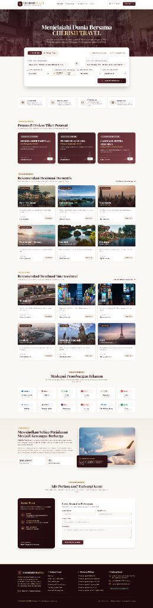

#### Tentang Kami
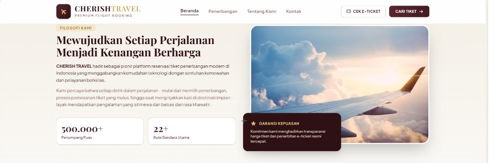

#### Hubungi Kami
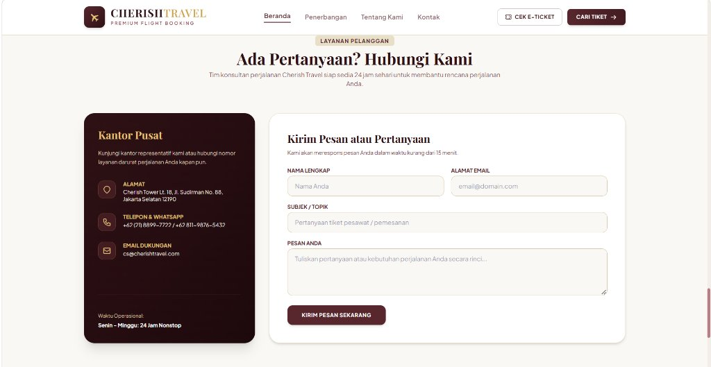

#### Form Pemesanan Tiket
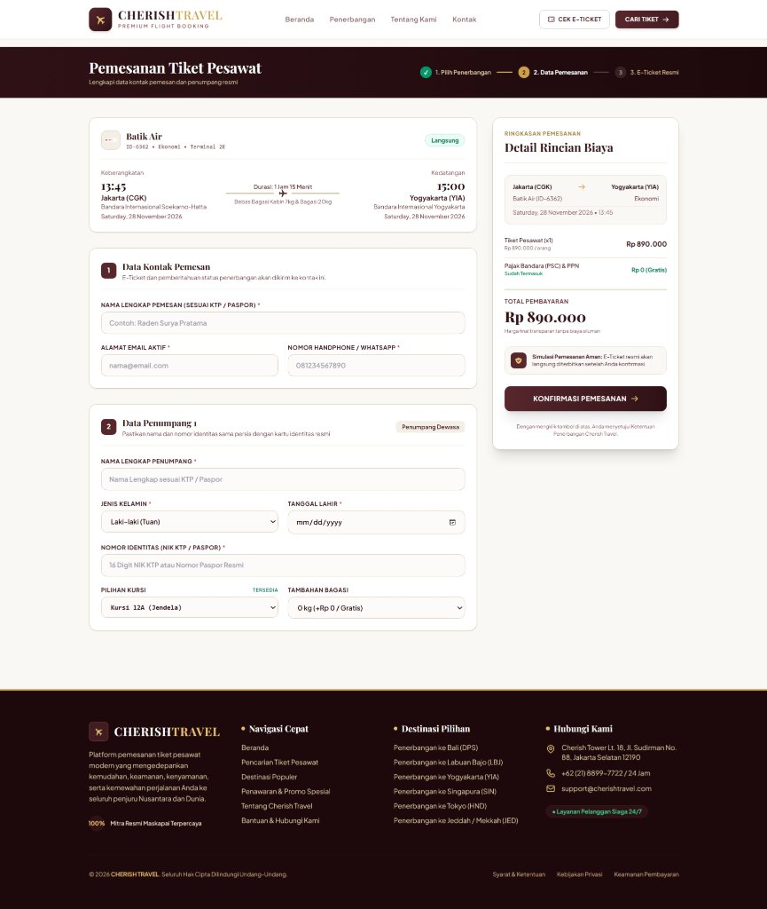

#### E-Ticket (Tiket Elektronik)
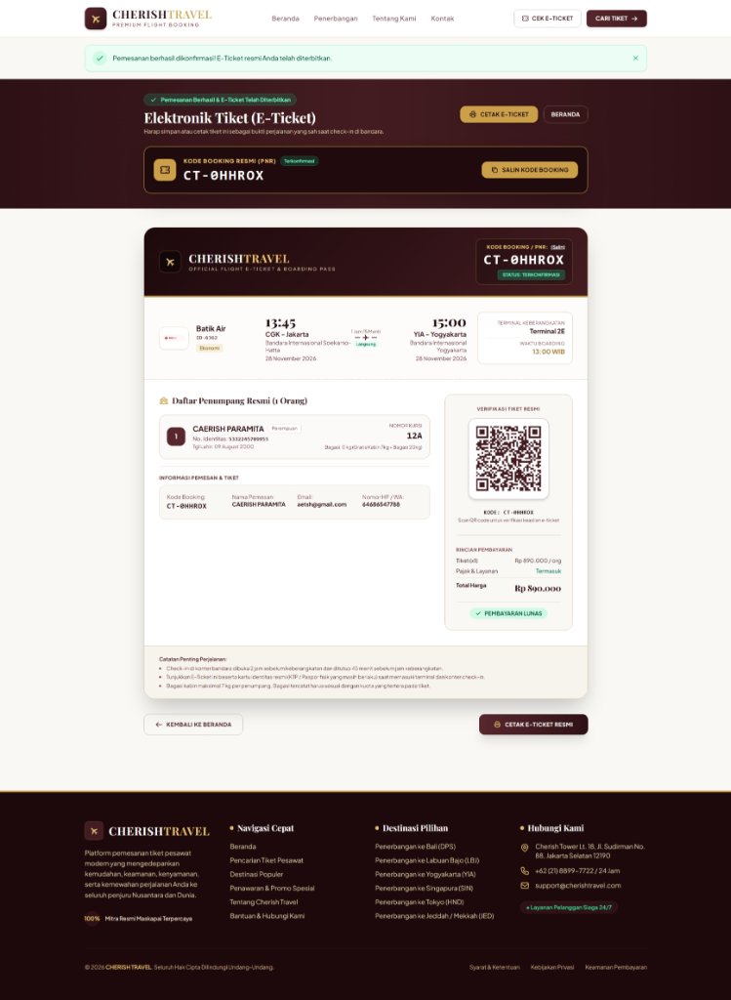

---

### Dashboard Admin

#### Login Admin
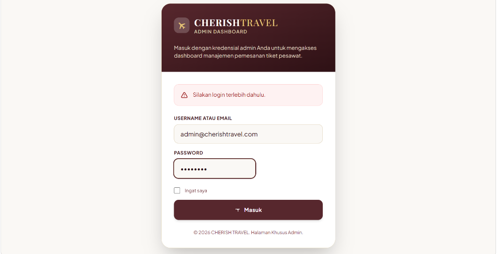

#### Dashboard — Ringkasan Bisnis
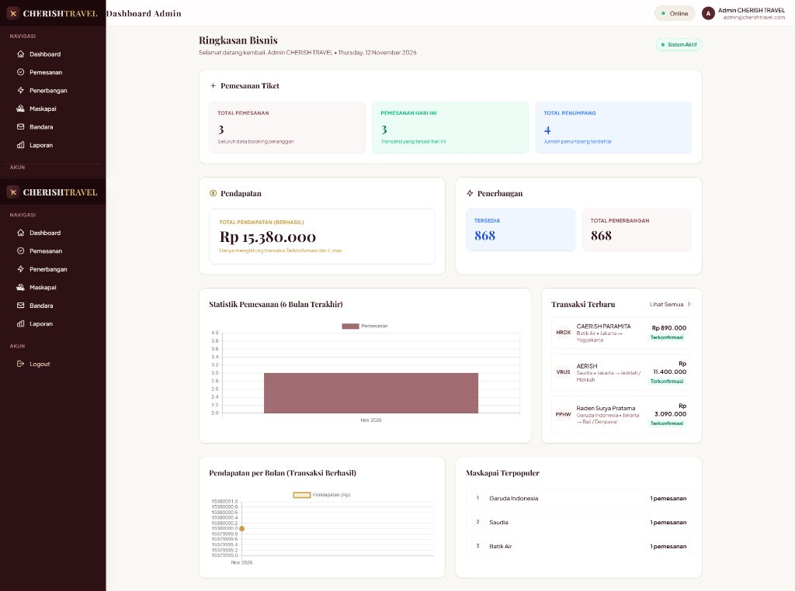

#### Manajemen Pemesanan
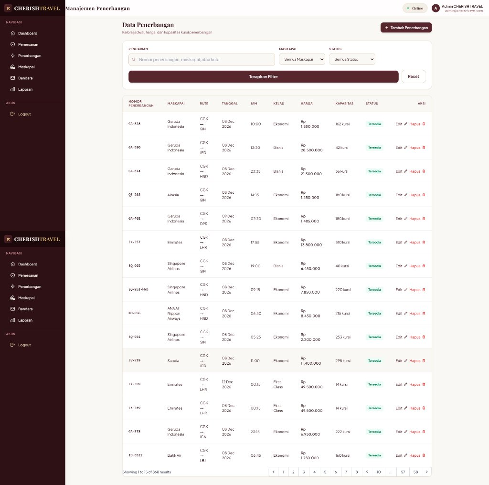

#### Manajemen Penerbangan
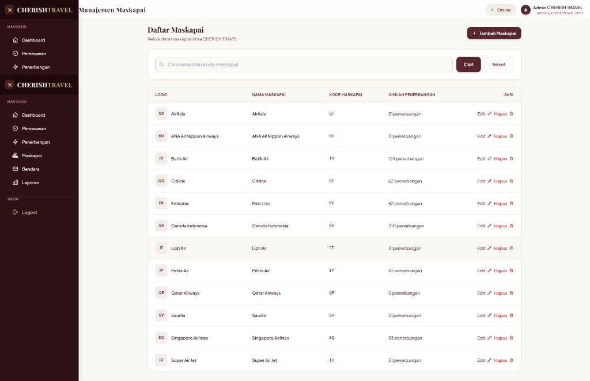

#### Manajemen Maskapai
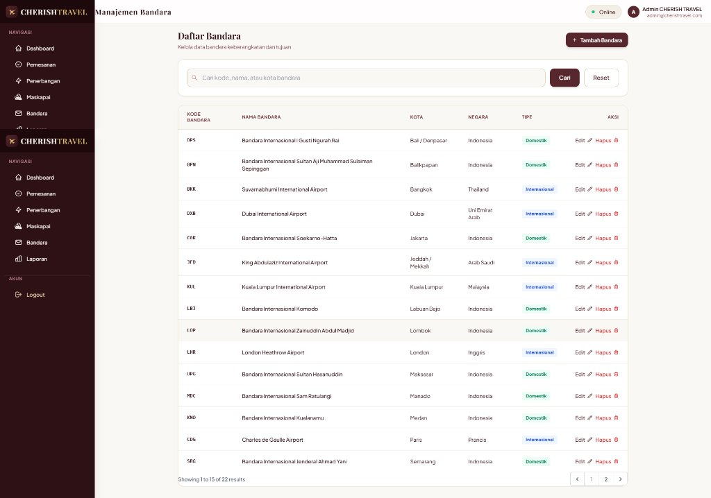

#### Manajemen Bandara
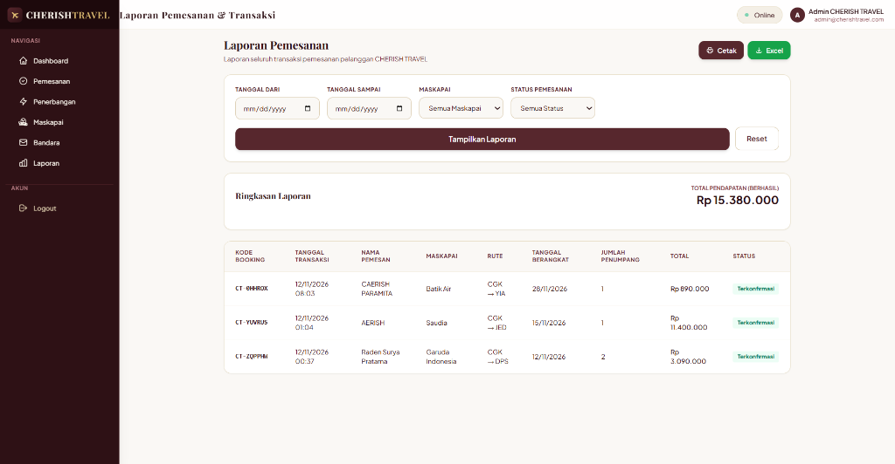

#### Laporan Pemesanan & Transaksi
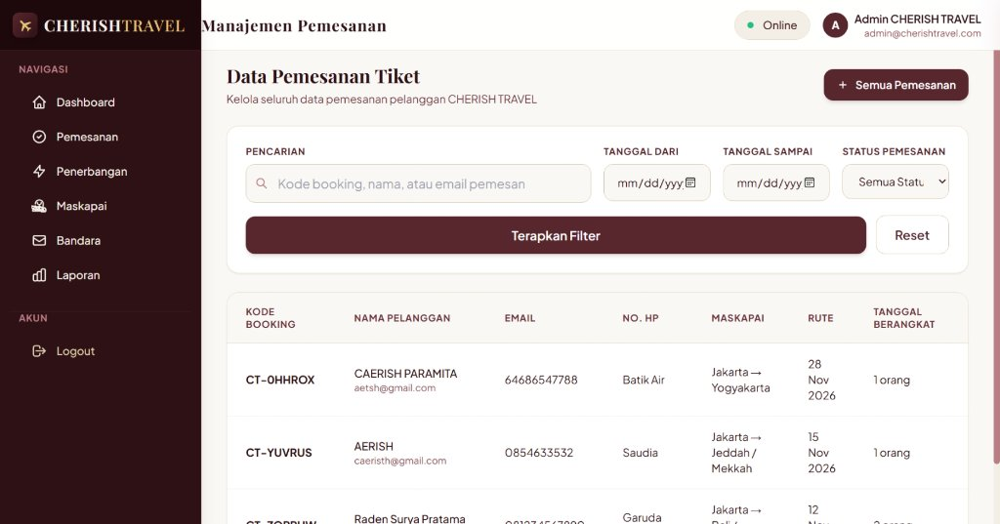

---

## 🛠️ Tech Stack

| Teknologi | Keterangan |
|-----------|------------|
| **Laravel 10** | PHP Framework |
| **PHP 8.1+** | Backend Language |
| **MySQL 8.0** | Database |
| **Tailwind CSS** | Styling & UI |
| **Vite** | Asset Bundler |
| **Blade** | Template Engine |
| **Laragon** | Local Development Environment |

---

## 🚀 Cara Install & Menjalankan

### Prasyarat
- PHP >= 8.1
- Composer
- MySQL
- Node.js & NPM

### Langkah Instalasi

```bash
# 1. Clone repository
git clone https://github.com/aanandadwimaharani-design/CHERISH-TRAVEL.git
cd CHERISH-TRAVEL

# 2. Install dependencies PHP
composer install

# 3. Install dependencies Node.js
npm install

# 4. Copy file environment
cp .env.example .env

# 5. Generate application key
php artisan key:generate

# 6. Buat database MySQL dengan nama: tiket_pesawat
# Lalu sesuaikan konfigurasi di file .env:
#   DB_DATABASE=tiket_pesawat
#   DB_USERNAME=root
#   DB_PASSWORD=

# 7. Jalankan migrasi & seeder database
php artisan migrate --seed

# 8. Import data penerbangan (opsional, untuk data lengkap)
# Import file: data_penerbangan_cherish.sql

# 9. Jalankan aplikasi
php artisan serve
```

### Akses Aplikasi
| Halaman | URL |
|---------|-----|
| **Website** | http://localhost:8000 |
| **Admin Dashboard** | http://localhost:8000/admin |

### Akun Admin Default
| Field | Value |
|-------|-------|
| Email | `admin@cherishtravel.com` |
| Password | *(sesuai seeder)* |

---

## 📁 Struktur Project

```
CHERISH-TRAVEL/
├── app/
│   ├── Http/Controllers/
│   │   ├── Admin/          # Controller admin (Dashboard, Booking, Flight, dll)
│   │   ├── AuthController.php
│   │   ├── BookingController.php
│   │   ├── FlightController.php
│   │   └── ...
│   ├── Models/             # Model (Airline, Airport, Booking, Flight, Passenger, User)
│   └── Exports/            # Export Excel untuk laporan
├── database/
│   ├── migrations/         # Migrasi tabel database
│   └── seeders/            # Seeder (Admin, Airline, Airport, Flight)
├── resources/views/
│   ├── admin/              # View halaman admin
│   ├── booking/            # View pemesanan
│   ├── penerbangan/        # View pencarian penerbangan
│   ├── tiket/              # View e-ticket
│   └── home.blade.php      # Halaman beranda
├── routes/web.php          # Definisi routing
├── public/images/airlines/ # Logo maskapai (SVG)
└── screenshots/            # Screenshot aplikasi
```

---

## 👩‍💻 Developer

**Aananda Dwi Maharani**

📧 Hubungi via GitHub: [@aanandadwimaharani-design](https://github.com/aanandadwimaharani-design)

---

<div align="center">

**© 2026 CHERISH TRAVEL.** Seluruh Hak Cipta Dilindungi Undang-Undang.

*Project UTS — Pemrograman Web dengan Laravel*

</div>
